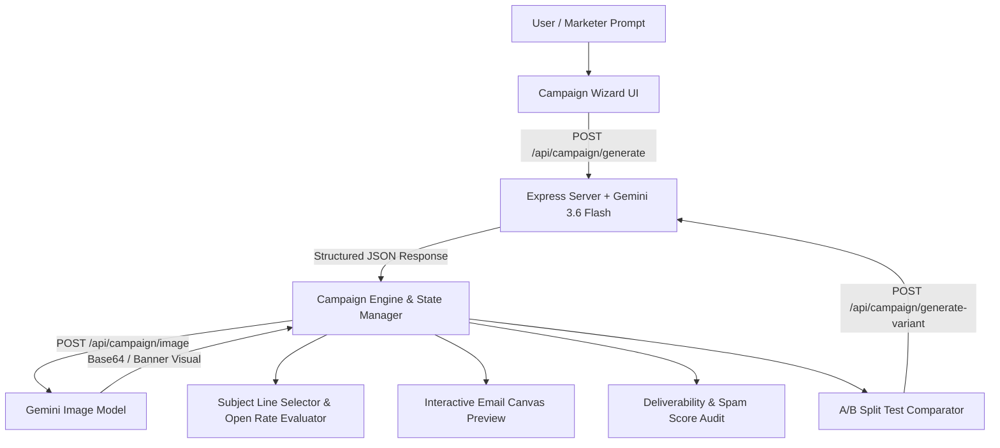
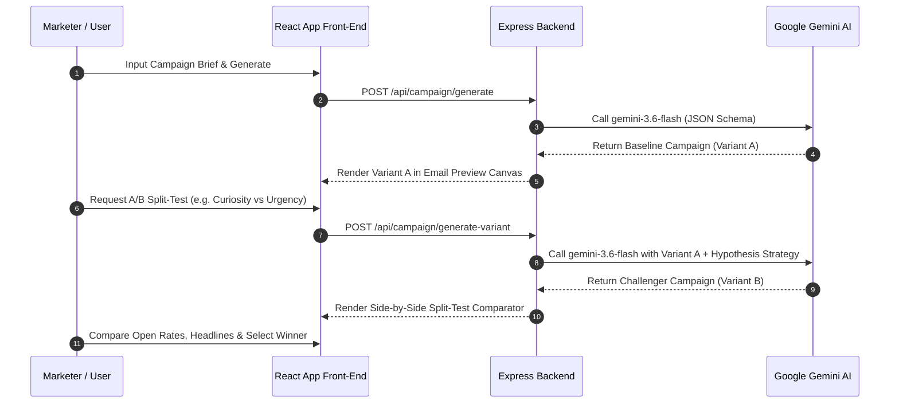

# ✉️ MailPulse — AI Email Marketing & Visual Campaign Generator

[](https://github.com/google/ai-studio)
[](https://react.dev)
[](https://ai.google.dev)
[](https://ai.google.dev)
[](https://tailwindcss.com)
[](https://www.typescriptlang.org)
[](LICENSE)

**MailPulse** is an enterprise-grade, full-stack AI platform designed to craft high-converting, complete email marketing campaigns in seconds. From strategic campaign briefs, MailPulse leverages **Google Gemini 3.6 Flash** and **Gemini Image Generation** to auto-generate subject lines, preview text, structured body copy, call-to-action buttons, spam score deliverability audits, and high-resolution visual hero banners.

It features an **A/B Split-Testing Engine** that generates and compares challenger variants side-by-side with hypothesis tracking, predicted open rates, and direct winner selection.

---

## 🌟 Core Features

- **⚡ Instant End-to-End Campaign Generation**: Generates 4 subject line variations with predicted open rates, inbox preview text, headlines, structured copy, value propositions, promo offer blocks, and footer compliance text.
- **🎨 AI Visual Hero Banner Generator**: Automatically crafts custom photographic or vector-styled header banners via Gemini's image generation API.
- **⚔️ A/B Split-Testing Comparator**: Generates a "Challenger" (Variant B) campaign to test hypotheses (e.g., *Urgency vs. Storytelling* or *Curiosity vs. Direct Offer*) side-by-side with full copy, image, and CTA comparison.
- **🛡️ Deliverability & Spam Filter Audit**: Analyzes email copy for spam trigger words, calculates an inbox score (0–100), and provides actionable deliverability recommendations for Gmail, Outlook, and Apple Mail.
- **📱 Responsive Mobile & Desktop Preview**: Instant canvas preview with toggles for Desktop (600px) and Mobile (375px) views, theme accent color selection, and inline live text editing.
- **🤖 AI Campaign Co-Pilot**: Refine tone, length, or narrative framing in real-time with conversational AI instructions or quick-action presets.
- **📤 Production HTML & Text Export**: Generates clean, table-formatted inline HTML compatible with Mailchimp, Klaviyo, HubSpot, SendGrid, and ActiveCampaign, alongside plain-text fallbacks and simulated inbox dispatch testing.
- **💾 History & Local Storage**: Auto-saves past campaigns locally for quick reference, editing, and comparison.

---

## 📐 System Architecture & Workflow

### 1. High-Level Data Flow Diagram



---

### 2. A/B Split-Testing Workflow



---

## 🛠️ Technology Stack

| Layer | Technologies Used |
| :--- | :--- |
| **Front-End Framework** | React 19, TypeScript, Vite |
| **Styling & UI** | Tailwind CSS v4, Lucide Icons, Motion |
| **Back-End Runtime** | Node.js, Express.js, `tsx`, `esbuild` |
| **AI Models** | `@google/genai` (Gemini 3.6 Flash & Gemini Image Gen) |
| **Code Formatting** | Inline HTML generator with CSS table support for email clients |

---

## 🚀 Quick Start & Installation

### Prerequisites

- **Node.js**: `v20.0.0` or higher
- **Gemini API Key**: Set inside `.env` or injected at runtime via process environment variables.

### Environment Setup

Create a `.env` file in the root directory:

```env
GEMINI_API_KEY="your_google_gemini_api_key_here"
PORT=3000
```

### Installation Steps

1. **Clone the repository**:
   ```bash
   git clone https://github.com/your-username/mailpulse.git
   cd mailpulse
   ```

2. **Install dependencies**:
   ```bash
   npm install
   ```

3. **Start Development Server**:
   ```bash
   npm run dev
   ```
   *The application will launch on `http://localhost:3000`.*

4. **Production Build**:
   ```bash
   npm run build
   npm start
   ```

---

## 📡 Backend API Endpoints

| Endpoint | Method | Description |
| :--- | :--- | :--- |
| `/api/campaign/generate` | `POST` | Generates a complete baseline email marketing campaign from prompt parameters. |
| `/api/campaign/image` | `POST` | Generates a wide-landscape (16:9) visual hero banner graphic using Gemini Image AI. |
| `/api/campaign/refine` | `POST` | Refines copy, tone, or structure of an existing campaign based on co-pilot instructions. |
| `/api/campaign/generate-variant` | `POST` | Creates an A/B split-test challenger campaign (Variant B) testing a specific strategy. |

---

## 📂 Project Directory Structure

```
.
├── server.ts                    # Express backend entry point & Gemini API proxy
├── src/
│   ├── App.tsx                  # Main React application & state controller
│   ├── types.ts                 # Shared TypeScript interfaces & models
│   ├── components/
│   │   ├── Header.tsx           # Sticky navigation header & quick actions
│   │   ├── CampaignWizard.tsx   # Campaign brief input form & preset starters
│   │   ├── SubjectLineSelector.tsx # Subject line options, char counters & A/B picker
│   │   ├── EmailPreview.tsx     # Desktop/Mobile interactive email canvas
│   │   ├── SplitTestComparator.tsx # Side-by-side A/B campaign comparison grid
│   │   ├── RefinementAssistant.tsx # AI Co-Pilot prompt refinement bar
│   │   ├── SpamCheckModal.tsx   # Deliverability & spam score audit modal
│   │   ├── ExportModal.tsx      # HTML/Text exporter & test dispatch simulator
│   │   └── SavedCampaignsDrawer.tsx # Drawer for saved history campaigns
│   ├── data/
│   │   └── presets.ts           # Starter marketing presets (Flash sale, launch, etc.)
│   └── utils/
│       └── htmlGenerator.ts     # Email-safe inline CSS HTML string generator
├── metadata.json                # AI Studio application metadata
├── package.json                 # Project dependencies & build scripts
└── vite.config.ts               # Vite bundler configuration
```

---

## 📄 License

Distributed under the Apache 2.0 License. See `LICENSE` for details.
